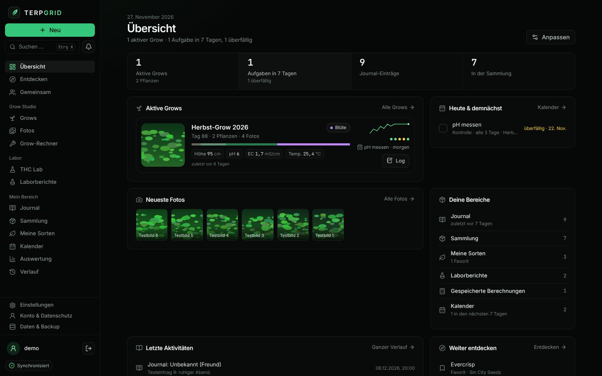
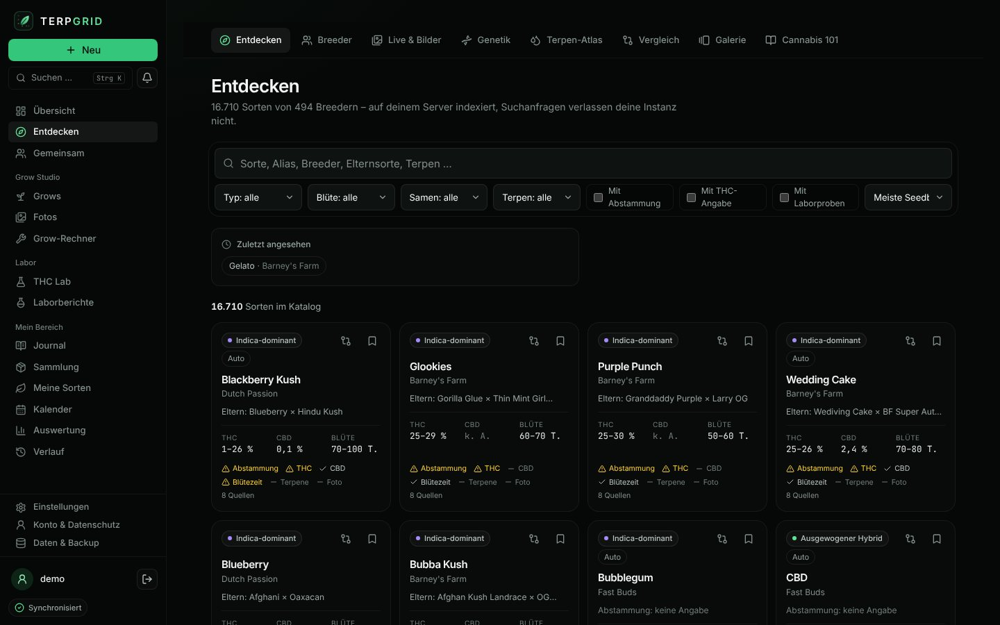
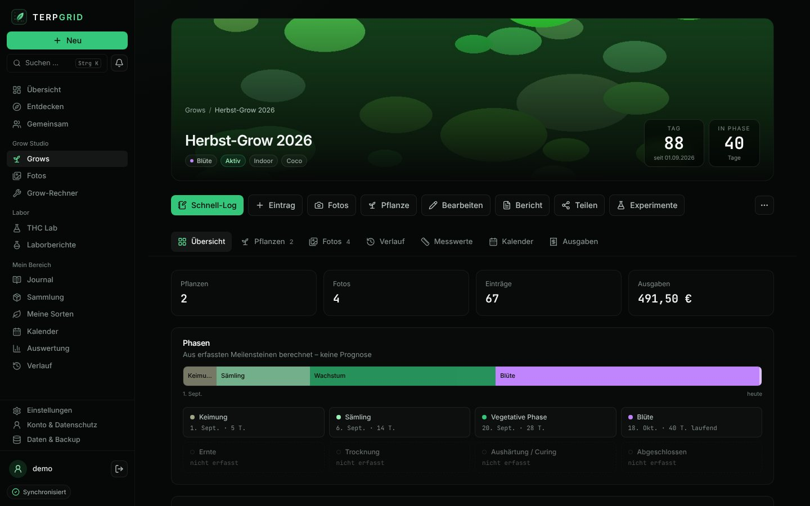
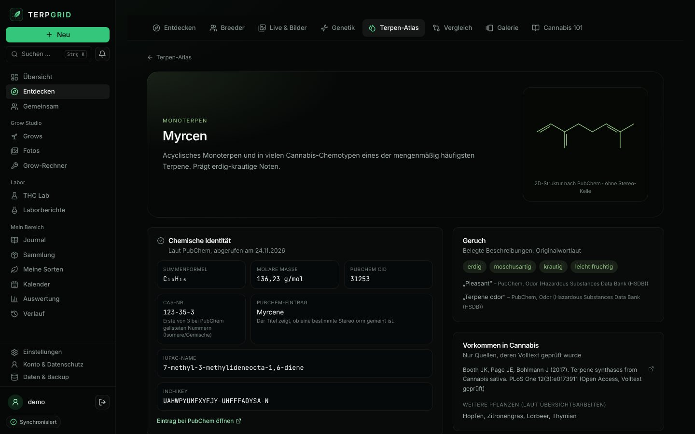
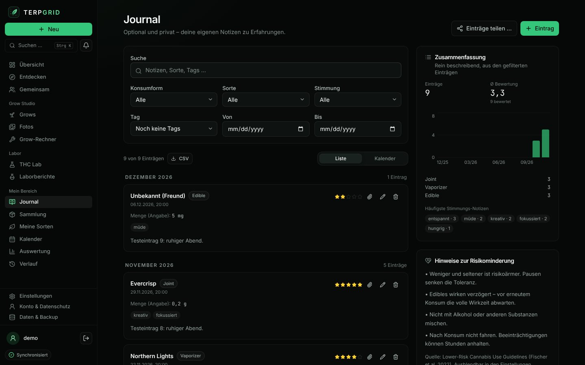
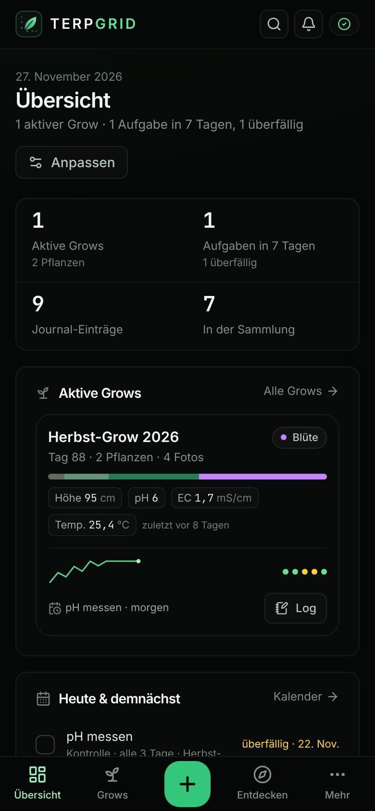
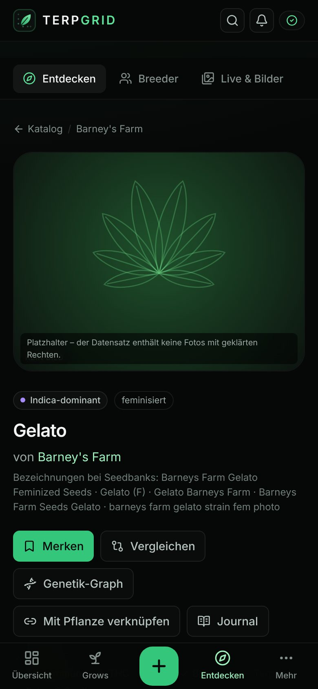
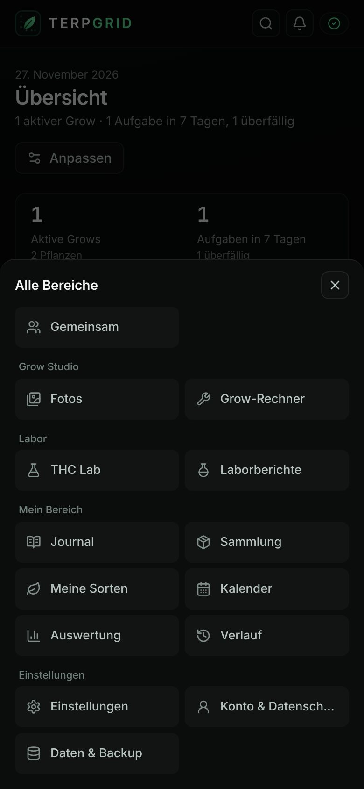

<div align="center">


# TERPGRID

**Your cannabis ecosystem. Your data. Your infrastructure.**

A modern, self-hosted platform for cannabis knowledge, personal organization,<br>
cultivation documentation, scientific exploration and private collaboration.


[Features](#explore-the-platform) · [Getting started](#getting-started) · [Documentation](#documentation) · [Privacy & security](#privacy-by-design)

<br>



</div>

<br>

## Overview

TERPGRID brings together the things a cannabis enthusiast or home grower usually keeps in a dozen different places:
- a searchable cultivar and breeder encyclopedia;
- a library of sourced educational articles;
- detailed cultivation logs with plants, measurements and photos;
- a personal journal, collection and calendar;
- scientific tools for estimating potency;
- private spaces to share selected records with people you trust.

Everything runs on infrastructure you control. Accounts do not require an email address, content is encrypted on your server, and the application works without third-party analytics or tracking. You decide who has an account, what is shared and where backups are stored.

The application interface is currently available in **German**.

## Explore the platform

**Discover & learn**
- Browse a locally indexed catalog of **16,710 cultivars from 494 breeders**, with the source of every value shown.
- Follow documented parent–child relationships in an interactive genetics explorer.
- Look up **27 terpenes** with PubChem-verified chemical identities.
- Read **30 sourced articles** in *Cannabis 101*, with learning paths and a glossary.

**Document & organize**
- Run grow projects with phases, plant profiles, quick logs and photo timelines.
- Track measurements: pH, EC, climate, VPD and DLI, each with its measuring context.
- Keep a private journal, a collection with equipment and expenses, and a calendar with recurring tasks.
- One overview brings activity from every module together.

**Analyze & understand**
- Record laboratory reports with their original documents.
- Compare grows and cultivars side by side, and print project reports.
- Review descriptive personal statistics.
- The THC Lab estimates edible and joint potency with explicit uncertainty ranges and cited formulas, never as precise dosing advice.

**Connect & collaborate**
- Add friends by exact handle or invitation link. There is no public user directory.
- Share selected records into private spaces with owner, edit, comment and view roles, per-item access and comments.
- Revoke access instantly.

**Access anywhere**
- A responsive web app for desktop and mobile, installable as a PWA.
- Offline use is opt-in per device and account; without it, the local copy is removed on logout.

**Stay in control**
- Docker Compose deployment with automatic HTTPS.
- Invitation-only registration by default.
- An admin area that shows metadata, never content.
- Scripted upgrades with rollback, and encrypted off-site backups with restore tests.

## Application preview

<table>
  <tr>
    <td width="50%"><br><sub><b>Cultivar catalog</b> · search, filters and per-value evidence</sub></td>
    <td width="50%"><br><sub><b>Grow Studio</b> · phases, plants, measurements and photos</sub></td>
  </tr>
  <tr>
    <td width="50%"><br><sub><b>Terpene Atlas</b> · chemical identity and literature</sub></td>
    <td width="50%"><br><sub><b>Personal workspace</b> · journal, filters and summary</sub></td>
  </tr>
</table>

<table>
  <tr>
    <td width="33%"></td>
    <td width="33%"></td>
    <td width="33%"></td>
  </tr>
</table>

<sub>All screenshots use a synthetic demo account and demo records.</sub>

## Privacy by design

TERPGRID is built so that your records stay yours. It is honest about what that protection covers.

| | |
| --- | --- |
| **Self-hosted** | All data lives on your server: PostgreSQL, file storage and your backup target. Catalog lookups go through your server, and personal data is never sent to catalog providers. |
| **Accounts** | Username or generated account ID, no email required. Passwords are hashed with Argon2id. Optional TOTP two-factor authentication, passkeys (WebAuthn) and one-time recovery codes. Sessions can be reviewed and revoked individually. |
| **Encryption at rest** | Content, photos and shared spaces are encrypted with AES-256-GCM. Each account and each space has its own key, wrapped by the server's master key, and keys can be rotated. |
| **Isolation** | Every account's data is separated by PostgreSQL Row-Level Security. The application role cannot bypass it. |
| **Collaboration** | Roles and per-item access levels are enforced on the server; revoking access takes effect immediately. |
| **Media** | Photos are re-encoded on import, which removes embedded metadata including GPS. Files are served only to authorized accounts. |
| **Offline** | The local browser copy is kept beyond a session only if you enable offline use on that device. A shared-device mode clears it on logout. |
| **Backups** | Encrypted off-site backups with restic, scripted restore tests and a documented disaster-recovery procedure. |

> **Server-side, not end-to-end.** Encryption protects data on disk and in backups. Whoever controls the running server *and* its master key can technically decrypt content. TERPGRID does not claim zero-knowledge or end-to-end encryption. The reasoning is documented in [`docs/E2EE-DECISION.md`](docs/E2EE-DECISION.md).

The browser's working copy is not encrypted. Details: [Security](docs/SECURITY.md) · [Threat model](docs/THREAT-MODEL.md).

## Getting started

### Requirements

- A Linux server (Debian 12 or Ubuntu 24.04 recommended) with **≥ 2 vCPU, ≥ 2 GB RAM, ≥ 20 GB SSD**.
- A domain pointing to the server, for automatic HTTPS via Let's Encrypt.
- **Docker Engine ≥ 24** with the Compose plugin, plus `git`, `openssl`, `restic` and `rsync`.

### Install

```bash
sudo git clone https://github.com/compression-sh/terpgrid.git /opt/terpgrid
cd /opt/terpgrid/deploy
sudo ./install.sh      # asks for your domain, generates configuration and secrets, builds and starts
docker compose ps      # all services should report "healthy"
```

`install.sh` runs a preflight check, never overwrites existing secrets, and waits until all services are healthy.

**Afterwards:** back up `deploy/secrets/master_keys` and `hmac_secret` offline. Without the master key, encrypted content cannot be recovered.

### Create the first account

There is no default administrator and no default password. Create an invitation, register through the link, then promote the account:

```bash
docker compose exec api node dist/cli.js invite 7 "Admin"    # one-time invitation link, valid for 7 days
docker compose exec api node dist/cli.js promote <login>     # grant the admin role
```

Further invitations can be created inside the app.

### Optional: import the cultivar catalog

```bash
sudo ./import-catalog.sh --dry-run && sudo ./import-catalog.sh   # CI-Strains-Pro (CC BY 4.0)
sudo ./import-samples.sh --dry-run && sudo ./import-samples.sh   # public lab samples (CC0)
```

### Where to go next

| Topic | Guide |
| --- | --- |
| Configuration, HTTPS, key rotation | [Deployment guide](docs/DEPLOYMENT.md) |
| Upgrades and rollback | [`UPGRADE-6.0.md`](docs/UPGRADE-6.0.md) |
| Backups | [`BACKUP.md`](docs/BACKUP.md) |
| Troubleshooting | [`RUNBOOK.md`](docs/RUNBOOK.md) |

### Try it without a server

```bash
npm install --legacy-peer-deps
npm run dev
```

This starts the app in *local mode*:
- data stays in your browser;
- no accounts, no synchronization, no collaboration.

## Technology

| Layer | Stack |
| --- | --- |
| Frontend | React 19, TypeScript, Vite, Tailwind CSS 4, Recharts; IndexedDB working copy with a sync engine; service worker (PWA) |
| Backend | Node.js 22, Fastify 5; Argon2id, TOTP and WebAuthn passkeys; AES-256-GCM envelope encryption |
| Database | PostgreSQL 16 with Row-Level Security |
| Operations | Docker Compose, Caddy (automatic HTTPS, security headers), restic backups, systemd timers |
| Quality | Vitest (frontend and backend integration tests against PostgreSQL), Playwright smoke test, ESLint, gitleaks secret scanning in CI |

## Documentation

Detailed documentation is currently written in German. A structured index is available in [`docs/README.md`](docs/README.md).

| Area | Documents |
| --- | --- |
| Installation & configuration | [Deployment](docs/DEPLOYMENT.md) · [Production checklist](docs/PRODUCTION-CHECKLIST.md) · [Server hardening](docs/PHASE5-7-VPS-HARDENING.md) |
| Administration & maintenance | [Runbook](docs/RUNBOOK.md) · [Maintenance](docs/MAINTENANCE.md) · [Upgrade to 6.0](docs/UPGRADE-6.0.md) |
| Backup & recovery | [Backups](docs/BACKUP.md) · [Disaster recovery](docs/PHASE5-9-DISASTER-RECOVERY.md) |
| Security & privacy | [Security](docs/SECURITY.md) · [Threat model](docs/THREAT-MODEL.md) · [Encryption decision](docs/E2EE-DECISION.md) · [Security acceptance 6.0](docs/RELEASE-6.0-SECURITY.md) |
| User guides | [Installing the app (PWA)](docs/PHASE5-6-PWA-GUIDE.md) · [Offline architecture](docs/PHASE5-6-OFFLINE-ARCHITECTURE.md) |
| Data sources | [Catalog & datasets](docs/CATALOG.md) |
| Development | [Architecture](docs/ARCHITECTURE.md) · [Information architecture](docs/INFORMATION-ARCHITECTURE.md) · [Design system](docs/DESIGN-SYSTEM.md) |

## Scientific data & transparency

TERPGRID only shows data with a known source.

| Source | Content | License |
| --- | --- | --- |
| [CI-Strains-Pro](docs/CATALOG.md) | cultivar catalog | CC BY 4.0 |
| Smith et al. 2022 | laboratory samples | CC0 |
| PubChem | terpene identities | |
| Open-access studies | *Cannabis 101* articles | |

**Every value carries its origin:** breeder, seed bank, database or your own lab report. Contradictions between sources and missing information are shown, not filled in.

**What the data does not contain:**
- Most cultivars have **no verified chemical profile**.
- There are no quantitative, breeder-specific terpene profiles.
- THC and CBD figures exist for only part of the catalog and are mostly vendor statements.

**Laboratory samples are matched by product name.** They describe products that shared a name, not a specific breeder's line, and are labeled accordingly. No cultivar photos are shown without cleared rights.

Details and limitations: [`docs/CATALOG.md`](docs/CATALOG.md).

## Project status

The current version on `main` is **6.0.1**. It refines the interface and information architecture on top of 6.0.0.

6.0.0 has been prepared as the first stable release. Its publication is pending final testing on physical devices and operator sign-off, so **no tagged release has been published yet**.

Changes are recorded in the [changelog](CHANGELOG.md); release notes for 6.0 are in [`docs/RELEASE-NOTES-6.0.md`](docs/RELEASE-NOTES-6.0.md).

## Contributing

TERPGRID is developed in a private repository without a public contribution process. If you have access:
- open an issue or a pull request against `main`;
- CI must pass (type checks, tests, lint, dependency audit, deployment checks, secret scan).

To set up the project locally:

```bash
npm install --legacy-peer-deps && npm test && npm run lint && npm run build
cd server && npm install --legacy-peer-deps && TEST_PG_URL=postgres://… npm test
```

## License

No license has been published for this repository. Without a license, no permission to use, modify or distribute the code is granted.

## Disclaimer

TERPGRID is a tool for information and personal documentation. It does not provide medical, legal or dosing advice, and its estimates are not a substitute for professional guidance.

Laws on the possession, cultivation and use of cannabis differ between countries and regions. You are responsible for complying with the laws that apply to you.
